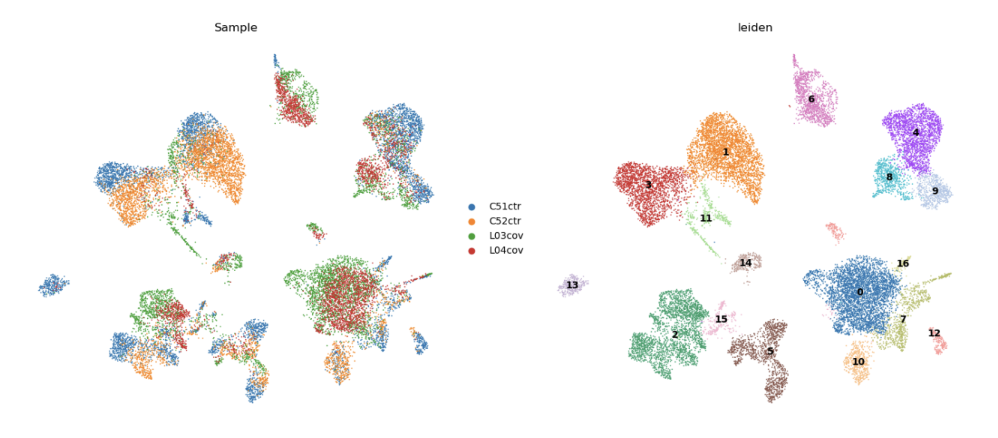

# Single-Cell Transcriptomic Reanalysis of Severe / Lethal COVID-19 Lung Tissue

End-to-end single-cell RNA-seq reanalysis using **Scanpy** and **scVI** (`scvi-tools`) to characterize cellular composition, lineage remodeling, and compartment-specific transcriptional responses in COVID-19 versus control lung tissue.

### 📄 Full Analysis & Code Walkthrough
* **[View Complete PDF Run (`reports/lethal_covid19_sc_rna_full_analysis_pt1.pdf`)](reports/lethal_covid19_sc_rna_full_analysis_pt1.pdf) and [(`reports/lethal_covid19_sc_rna_full_analysis_pt2.pdf`)](reports/lethal_covid19_sc_rna_full_analysis_pt2.pdf)** — Includes workflow execution, marker gene evaluation, scVI denoising, composition summaries, and differential expression analyses.

---

### 🔑 Key Biological Takeaways

* **Epithelial Loss & Alveolar Remodeling:** Control samples retain prominent `AT1_Cells` and `AT2_Cells` populations, whereas COVID-19 samples show marked depletion of mature alveolar epithelial representation alongside strong myeloid/immune expansion.
* **AT2 Transitional / Injury-Repair Dynamics:** Injured `AT2_Cells` in COVID-19 show reduced canonical lineage markers alongside up-regulation of AT1-associated/repair-linked genes, consistent with progenitor stress and epithelial regeneration programs under severe viral injury.
* **Inflammatory vs. Homeostatic Shift:** COVID-19 profiles highlight pro-inflammatory chemokine and immune activation (`CCL8`, `CXCL9`, `CXCL10`, `FCGR3A`, `CD163`, `GZMB`, immunoglobulin transcripts) paired with reduced homeostatic/barrier/clearance signatures (`MARCO`, `CTSD`, `COL4A5`).
* **Compartment-Specific Responses:** Interaction differential expression resolves distinct transcriptional programs across epithelial, myeloid/lymphoid, endothelial, and stromal/fibroblast compartments.

---

### 📊 Visual Highlights

#### 1. Sample Distribution & Leiden Clustering

#### 2. Cell-Type Annotation & scVI Denoised Marker Profiles

#### 3. Cellular Composition Shift (COVID-19 vs. Control)

#### 4. Differential Expression & AT1 / AT2 State Transitions

#### 5. Cell-Type-Specific COVID-19 Response (Interaction DE)

---

### 🧰 Methods & Stack
* **Frameworks:** `Python`, `Scanpy`, `scVI-tools` (`scVI` latent representation, denoised expression, and differential expression)
* **Core Steps:** Quality control & marker panel screening, scVI integration & Leiden clustering, cell-type annotation, compositional comparison, global DE, AT1/AT2 comparative profiling, and cell-type interaction DE.
