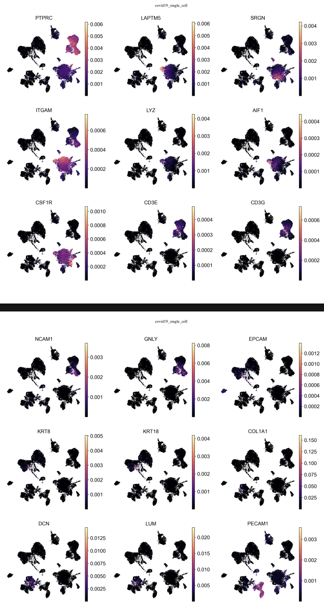
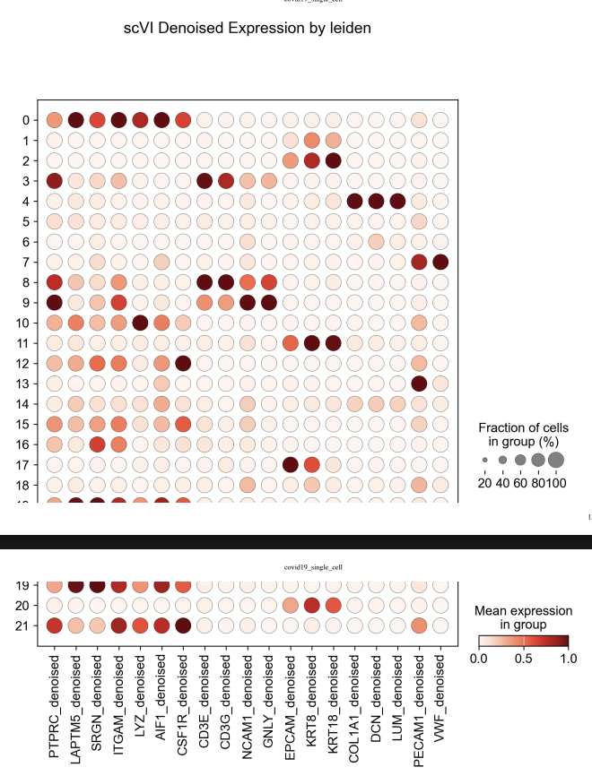
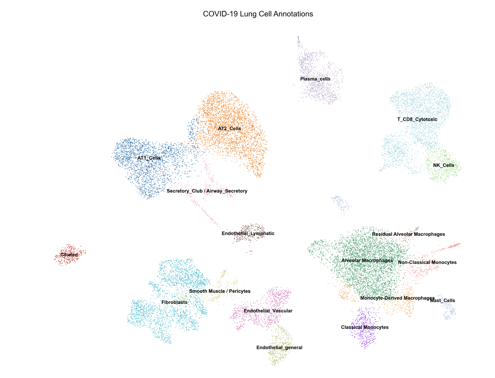
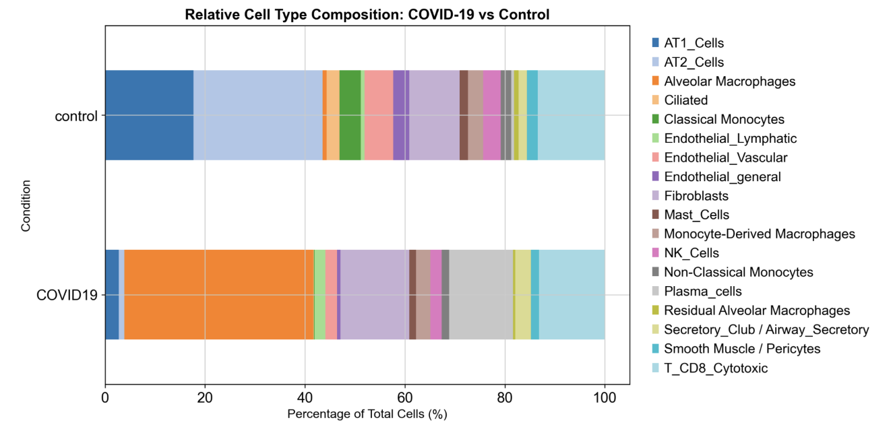
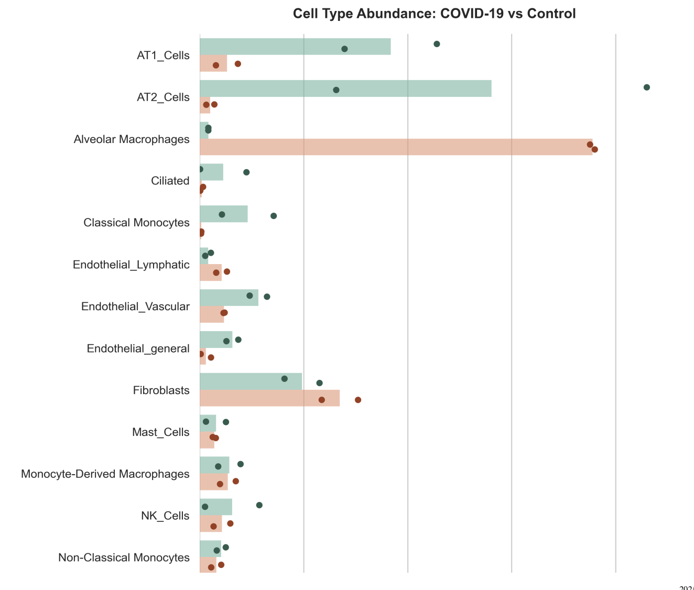
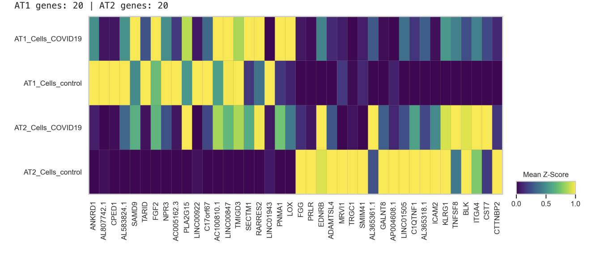
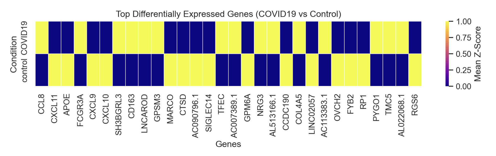
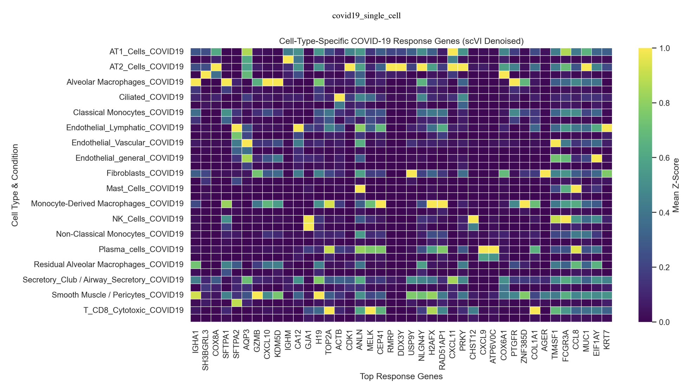

# Single-Cell Transcriptomic Reanalysis of Severe / Lethal COVID-19 Lung Tissue

End-to-end single-cell RNA-seq reanalysis using Scanpy and scVI (`scvi-tools`) to characterize cellular composition, lineage remodeling, and compartment-specific transcriptional responses in COVID-19 versus control lung tissue.

## 📄 Full Analysis & Code Walkthrough (3-Part Workflow)
- **Part 1:** `reports/pt1_lethal_covid19_sc_rna_full_analysis_pt1.pdf` (`jupyter_notebook/pt1_covid19_single_cell.ipynb`) — Initial workflow setup, sample-level doublet detection and quality control, and cohort integration.
- **Part 2:** `reports/pt2_lethal_covid19_sc_rna_full_analysis_pt2.pdf` (`jupyter_notebook/pt2_covid19_single_cell.ipynb`) — Clustering, marker screening, cell-type annotation, and initial downstream exploration.
- **Part 3:** `reports/pt3_lethal_covid19_sc_rna_full_analysis_pt3.pdf` (`jupyter_notebook/pt3_covid19_single_cell.ipynb`) — Condition composition comparisons, AT1/AT2 analysis, and differential expression.

## 🔑 Key Biological Takeaways
- **Epithelial Loss & Alveolar Remodeling:** Control samples retain prominent `AT1_Cells` and `AT2_Cells` populations, whereas COVID-19 samples show marked depletion of mature alveolar epithelial representation alongside strong myeloid/immune expansion.
- **AT2 Transitional / Injury-Repair Dynamics:** Injured `AT2_Cells` in COVID-19 show reduced canonical lineage markers alongside up-regulation of AT1-associated/repair-linked genes, consistent with progenitor stress and epithelial regeneration programs under severe viral injury.
- **Inflammatory vs. Homeostatic Shift:** COVID-19 profiles highlight pro-inflammatory chemokine and immune activation (`CCL8`, `CXCL9`, `CXCL10`, `FCGR3A`, `CD163`, `GZMB`, immunoglobulin transcripts) paired with reduced homeostatic/barrier/clearance signatures (`MARCO`, `CTSD`, `COL4A5`).
- **Compartment-Specific Responses:** Interaction differential expression resolves distinct transcriptional programs across epithelial, myeloid/lymphoid, endothelial, and stromal/fibroblast compartments.
- 
---

### 📊 Visual Highlights

#### 1. Sample Distribution & Leiden Clustering

#### 2. Canonical Marker Gene UMAPs

#### 3. scVI Denoised Expression Across Leiden Clusters

#### 4. Annotated Cell Types

#### 5. Relative Cell Type Composition (COVID-19 vs. Control)

#### 6. Cell Type Abundance Across Conditions

#### 7. AT1 vs. AT2 Lineage & Transitional State Heatmap

#### 8. Global Differential Expression (COVID-19 vs. Control)

#### 9. Cell-Type-Specific COVID-19 Response (Interaction DE)

---

### 🧰 Methods & Stack
* **Frameworks:** `Python`, `Scanpy`, `scVI-tools` (`scVI` latent representation, denoised expression, and differential expression)
* **Core Steps:** Quality control & marker panel screening, scVI integration & Leiden clustering, cell-type annotation, compositional comparison, global DE, AT1/AT2 comparative profiling, and cell-type interaction DE.

---

## Data & Citation

- **Source Dataset:** GEO accession `GSE171524` (Melms et al., *Nature*, 2021).
- **Repository Citation:** If you use or reference this reanalysis code, please cite this repository (`Dskies5i/single_cell_lethal_covid19_reanalysis`) along with the original study.
